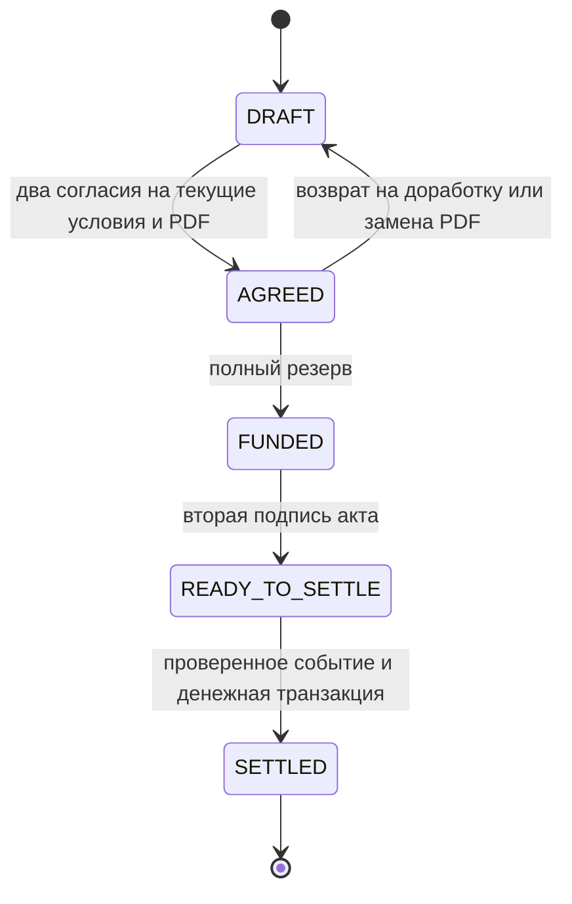

# Состояния сделки и разрешённые действия

Исходный контракт: 19 октября 2026 года. На 22 октября реализованы DRAFT → AGREED, новая DRAFT при изменении условий / PDF и доработке, а также вычисляемый при наступлении срока REVIEW_REQUIRED. Денежные состояния / переходы и реальные гонки с reserve остаются проектом; весь набор ниже не следует считать реализованным. Пользователь утвердил возврат согласованной сделки на доработку до резерва. Основание — [ТЗ](TZ.md), [API](API.md), [модель данных](DATA_MODEL.md) и [архитектура](ARCHITECTURE.md); фактические проверки — в [STATUS.md](STATUS.md).

## Общие правила

Заказчик и исполнитель — организации конкретной сделки; субъект определяется сессией. Обе стороны явно согласуют одну версию условий и точные байты PDF до резерва. После резерва каждая сторона отдельно подписывает акт. Создание сделки, согласование условий, подпись и выплата — разные факты.

`status` — сводное состояние. Спор, причина проверки, активный запрос отмены, резерв, согласования и подписи сохраняются независимо. UI показывает состояние вместе со всеми актуальными причинами блокировки. Сервер вычисляет допустимые действия по правам, фактам и текущему времени; скрытая кнопка не является проверкой полномочий. Фоновое обновление статуса не заменяет проверки под блокировкой в команде.

## Основной путь



Первая подпись сохраняется в FUNDED и денег не меняет. READY_TO_SETTLE означает ожидание обработки события, а не состоявшуюся выплату. Срок и отдельные блокирующие факты проверяются перед новым расчётом, даже если подписи были получены раньше.

## Матрица действий

| Состояние | Условия / документ | Основное действие | Исключения и завершение |
|---|---|---|---|
| DRAFT | Заказчик редактирует условия, загружает / генерирует PDF | Каждая сторона согласует актуальные условия и PDF; второе согласие даёт AGREED | Каждая сторона может запросить отмену; истечение срока ведёт в проверку |
| AGREED | Поля PATCH закрыты; заказчик может заменить PDF с новой версией и сбросом согласий | Заказчик создаёт резерв; любая сторона может вернуть на доработку с причиной | Любая сторона может открыть спор или запросить отмену; срок блокирует автоматическое продолжение |
| FUNDED | Условия и PDF неизменяемы | Каждая сторона подписывает только за себя | Спор / отмена / срок блокируют подписи и новую выплату |
| READY_TO_SETTLE | Условия и PDF неизменяемы | Система проверяет событие; только затем исполняет расчёт | Стороны ещё могут открыть спор / отмену; гонку решает БД |
| DISPUTED | Редактирование, резервирование и подписи закрыты | Стороны могут согласовать отмену | Автоматического возобновления выплаты или арбитража нет |
| CANCELLATION_PENDING | Условия и PDF не меняются | Другая организация принимает или отклоняет активный запрос | Спор не удаляет запрос; срок переводит в REVIEW_REQUIRED, сохраняя возможность принять отмену |
| REVIEW_REQUIRED | Редактирование, резервирование и подписи закрыты | Можно запросить согласованную отмену либо принять / отклонить уже активную | Новый запрос не снимает причину проверки; автоматической выплаты / освобождения нет |
| SETTLED | Только просмотр / история / экспорт в пределах прав | Расчёт завершён | Исходные деньги автоматически не изымаются; позднее требование вне текущего процесса |
| CANCELLED / REFUNDED | Только просмотр / история / экспорт в пределах прав | Сделка завершена | CANCELLED — без резерва; REFUNDED — освобождение ещё не выплаченного резерва |

Матрица описывает предметные действия; повтор уже выполненной команды обрабатывается по идемпотентности. Два действия одной организации не заменяют согласие второй. DEMO_OPERATOR не согласует и не подписывает за стороны, не возвращает сделку на доработку и не разрешает спор.

## Возврат на доработку

```text
POST /api/v1/deals/{id}/rework
Idempotency-Key: <ключ команды>
{ "deal_version": 2, "reason": "Нужно уточнить предмет работ" }
→ 200, обновлённый объект сделки
```

Доступен каждой стороне только из AGREED, до первого резерва, без открытого спора, активной отмены и причины проверки, до срока. `reason` — непустая строка после обрезки пробелов, максимум 2000 символов. Общие правила сессии, CSRF, типов и ключей остаются из API.

Под блокировкой сделки одной транзакцией:

1. Проверить актуальную `deal_version`, права, время, состояние и отсутствие прежнего резерва.
2. Создать неизменяемую версию `deal_version + 1` с прежними условиями и без активного PDF. Новый номер означает новое основание согласования, даже если значения полей ещё не исправлены.
3. Установить DRAFT, увеличить технический `row_version`. Старые согласия и версии PDF остаются историческими и больше не учитываются как текущие. Остатки и проводки не меняются.
4. Сохранить причину, actor, старую / новую версии в аудите, результат команды и outbox-уведомление обеим сторонам.

Заказчик исправляет условия в DRAFT, затем заново загружает / генерирует акт. Загрузка по существующим правилам снова увеличивает версию условий; после этого нужны два новых явных согласия. Если rework переводит 2 → 3, а изменения полей не понадобились, генерация документа переводит 3 → 4; обе стороны согласуют версию 4. Прежний PDF не становится активным автоматически; сгенерированный акт содержит итоговую сохраняемую версию.

Прежний ключ с прежним телом возвращает исторический результат без нового возврата в DRAFT, даже если сделка уже продвинулась дальше. Клиент перечитывает карточку для актуального состояния. Другое тело — 409 IDEMPOTENCY_CONFLICT; новый ключ с устаревшей версией — 409 VERSION_CONFLICT; недопустимое состояние — 409 INVALID_STATE. При истёкшем сроке — 422 DEADLINE_PASSED и предусмотренная проверка вместо доработки.

В DRAFT дополнительный возврат не нужен: редактирование уже открыто заказчику. В FUNDED / READY_TO_SETTLE и при споре / проверке действие запрещено. Отмена не превращается в обход этих ограничений: после резерва исправление требует согласованного завершения и новой сделки.

## Приоритет состояния и сохранение блокировок

Проектная конкретизация для единообразного отображения / фильтров:

1. Терминальный исход SETTLED / CANCELLED / REFUNDED сохраняется навсегда.
2. До терминального исхода наступивший срок или сохранённая причина проверки дают REVIEW_REQUIRED.
3. Иначе активный запрос отмены даёт CANCELLATION_PENDING.
4. Иначе открытый спор даёт DISPUTED.
5. Иначе обычная фаза определяется актуальными согласиями, активным резервом и подписями: DRAFT / AGREED / FUNDED / READY_TO_SETTLE.

Причины проверки, в том числе отклонённая отмена, сохраняются отдельно от status. Новая отмена после отказа не снимает их: объект может иметь status REVIEW_REQUIRED и активный запрос, который другая сторона вправе завершить. При споре во время отмены сохраняются оба факта; при истечении срока сохраняются и запрос, и согласие инициатора. Команда accept проверяет активный запрос и нетерминальность, а не требует исключительно status CANCELLATION_PENDING.

Изменяющая команда повторяет проверку времени после получения блокировок. Наступление срока запрещает резерв / подпись / выплату / rework, но не лишает стороны возможности согласованно отменить сделку. Серверная выдача карточки, фильтров и действий должна одинаково учитывать срок, даже если фоновая задача ещё не обновила сохранённую сводку. Это не автоматическая выплата и не возврат по таймауту.

## Конкурирующие действия и негативные сценарии

| Ситуация | Требуемый исход |
|---|---|
| Rework раньше reserve | Новая версия и DRAFT; резерв по прежней версии отклонён; деньги не меняются |
| Reserve раньше rework | FUNDED и активный резерв; rework отклонён; условия и PDF не меняются |
| Два rework с разными ключами на одну версию | Только один создаёт новую версию; второй получает конфликт |
| Повтор старого agree после rework | Исторический результат или конфликт версии; согласие не становится действующим для новой версии |
| Попытка согласовать без нового PDF | 422 DOCUMENT_REQUIRED; прежние согласия и файл не подставляются |
| Попытка резервировать DRAFT после rework | 409 VERSION_CONFLICT для прежней версии либо 409 INVALID_STATE для текущей; деньги не меняются |
| Спор / отмена раньше выплаты | Выплата заблокирована, резерв удержан до предусмотренного завершения |
| Выплата раньше спора / отмены | Расчёт остаётся единственным; поздняя команда не меняет его деньги |
| Дедлайн во время ожидания блокировки | Проверяется актуальное время; старое время начала запроса не разрешает действие |
| Истёк срок при активной отмене | REVIEW_REQUIRED; второй участник по-прежнему может принять отмену |
| Отмена отклонена, затем открыта новая | Новые ID / согласия; причина проверки сохраняется до терминального завершения |

Это критерии будущих интеграционных / HTTP / UI-проверок, а не выполненные тесты. Возврат покрывается A20 в ТЗ; прочие гонки — A04–A18. Следующий шаг — закрепление общего каркаса, миграций и контракта для двух разработчиков.
