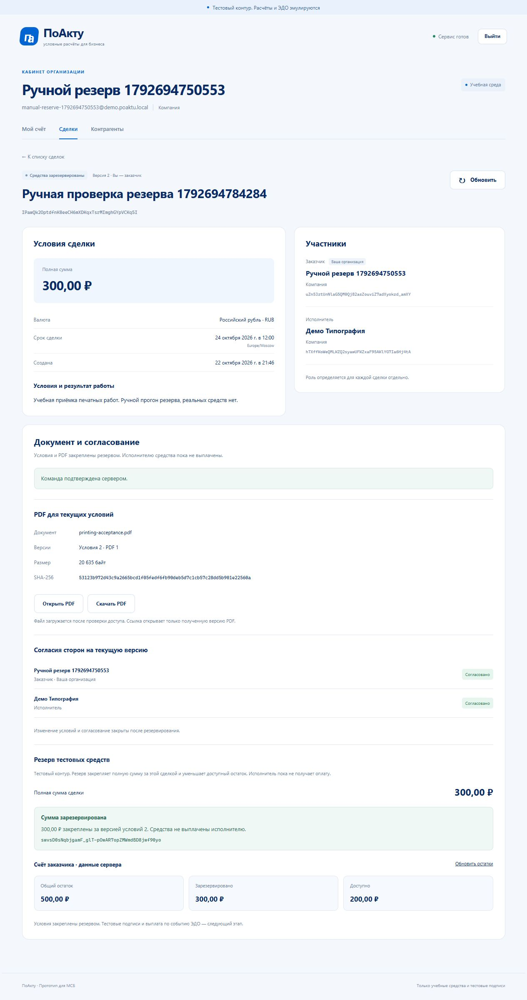
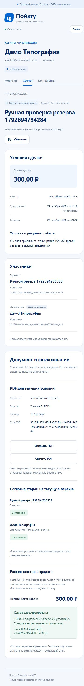
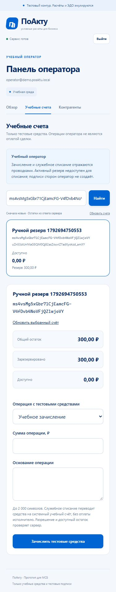
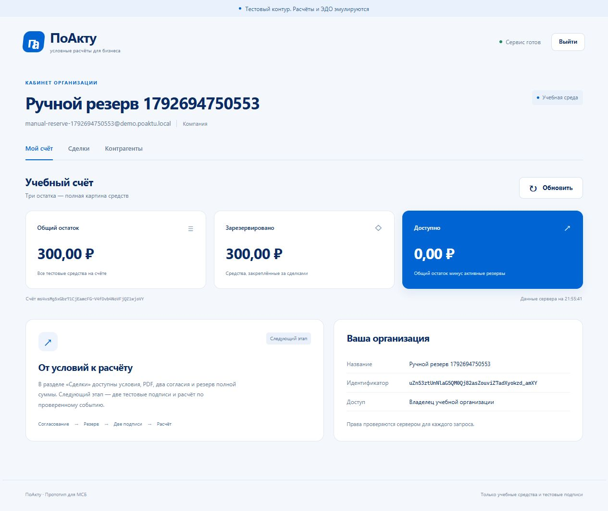

# Резервирование, денежные гонки и ручной UI — 22 октября 2026 года

Ветка `feature/deal-reserves`, [PR #11](https://github.com/Adopten123/digital-ruble-deals/pull/11) поверх PR #10. Реализован путь до FUNDED на учебных средствах. Тестовые подписи, ЭДО, выплата, спор, согласованное освобождение и A19 остаются следующими этапами.

## Реализация

Заказчик резервирует полную сумму AGREED-сделки при актуальном PDF и двух согласиях. Резерв закрепляет версию условий, документ / хеш, стороны, сумму и счёт; версия условий не растёт. Общий остаток сохраняется, зарезервированный увеличивается, доступный уменьшается. Условия, PDF и доработка после резерва закрыты; исполнитель видит резерв и не получает оплату.

Учебный оператор ищет клиентские счета, зачисляет средства с противосчёта DEMO_ISSUANCE и списывает доступную часть на фиксированный DEMO_DEBITS. Каждая операция создаёт две неизменяемые сбалансированные проводки. Общий ledger проверяет положительную сумму, источник, available и переполнение обоих счетов до записи. Резерв, проводки / проекции, статус, результат команды, аудит и pending outbox фиксируются транзакционно; срок повторно проверяется после ожидания счёта. PDF читается с проверкой размера / SHA-256 до денежных блокировок.

Добавлены четыре операции, всего 24 в OpenAPI. Миграция 004 создаёт резервы, результаты команд оператора и ограничения согласованности. Миграция 005 закрепляет поиск таблиц в защитных функциях. Повторный bootstrap добавляет системный счёт списаний, сохраняя прежние средства и пользователей. Клиент сохраняет неизвестные результаты до повтора исходного тела / ключа и перечитывает текущие данные после исторического ответа. Также исправлена обработка INVALID_DOCUMENT: определённый отказ PDF освобождает форму, сохраняя неизвестный исход заблокированным для новой команды; добавлена unit-регрессия.

## Автоматические проверки

| Набор | Результат |
|---|---|
| Полный Go с PostgreSQL 18.1 | `go test ./... -count=1` и `go vet ./...` пройдены; сборка успешна |
| Новые Go-проверки | 11 функций HTTP / PostgreSQL, три unit-теста ledger / service и отдельная функция с тремя TEMP-атаками |
| Frontend | **42 unit passed**, оба typecheck, production build |
| Контракт | OpenAPI валиден; 24 операции совпадают с маршрутами Go |
| Новые API / UI | 8 API и 5 UI сценариев; focused-прогоны с setup: 9 passed и 6 passed |
| Полный локальный набор | **90 passed за 2,7 минуты**: 42 API + 47 UI + setup, без повторов упавших сценариев |
| Linux / Compose / nginx | [CI на `3911c7f`](https://github.com/Adopten123/digital-ruble-deals/actions/runs/39834093520): **90 passed за 3,1 минуты**, Go race с PostgreSQL 18.6, vet, сборки, unit / typecheck / OpenAPI |
| Сквозной smoke / перезапуск | Создание → PDF → два согласия → credit → reserve → debit только available; повторный bootstrap и сохранение PDF / резерва / проводок / прежних результатов после перезапуска API пройдены локально и в CI |
| Независимая сверка БД | Счета совпали с суммой реальных проводок и ACTIVE-резервов, 0 расхождений |

Проверены конкурирующие резервы разных сделок, резерв против списания, несколько списаний, один ключ / изменённое тело, сохранённый недостаток после позднего пополнения, права, int64, доработка против резерва, срок после блокировки счёта, rollback при отказе outbox, повреждённый / отсутствующий PDF. Неизвестные ответы резерва и пополнения воспроизводятся после настоящего commit; повтор использует прежние версии, ключ, тело и пользователя.

Первый API-прогон выявил ошибку ожидания теста: оператор получает 404 для приватной сделки, как прочие посторонние субъекты. Исправлено ожидание без расширения прав. Первый общий прогон: 86 passed, один отказ и три не выполнены — setup layout получил 429 общего бюджета авторизации. Только этот hook теперь уважает серверный Retry-After с одним ограниченным повтором; лимиты приложения сохранены. После этого полный набор пройден. Геометрическая матрица 187 сочетаний также прошла.

## Найденный обход проверок БД

Независимый review обнаружил возможность подставить временные таблицы при прямом SQL-доступе под runtime-ролью. До исправления отдельный тест на случайных схемах воспроизвёл три обхода: неподтверждённый остаток, несбалансированная пачка и FUNDED без настоящего резерва. Все попытки откатывались; история учебного стенда не изменялась.

Миграция 005 задаёт всем восьми trigger-функциям `search_path = pg_catalog, <схема приложения>, pg_temp`; права SECURITY INVOKER сохраняются. После исправления все три атаки отклоняются. Read-only проверка подтвердила настройки и отсутствие CREATE в public у runtime. Порядок поиска и необходимость учитывать временную схему описаны в официальной документации PostgreSQL: [schemas](https://www.postgresql.org/docs/18/ddl-schemas.html#DDL-SCHEMAS-PATH), [CREATE FUNCTION](https://www.postgresql.org/docs/18/sql-createfunction.html#SQL-CREATEFUNCTION-SECURITY).

Это защита ограниченной роли и целостности реестра. Администратор БД может изменить схему / отключить триггеры; независимое обнаружение вмешательства A19 ещё не реализовано.

## Ручной прогон

Выполнен через интерфейс браузера на отдельном стенде 18080 / 18081 после автоматизации, без подмены ответов. Новая компания `Ручной резерв 1792694750553`, счёт `ms4vsMg5xGbr71CjEamcFG-V4fDvb4NoVFjQZ1wjoVY`, сделка `IPawQk2OptdfnK8eeCH6mXDKqxTsrMImghGYpVCKq5I`. Реальных средств / данных нет; исходный общий демобаланс не использовался.

| ID | Фактически выполнено | Результат |
|---|---|---|
| R01 | Регистрация компании, нулевые три остатка, отсутствие операторской вкладки | PASS |
| R02 | Поиск исполнителя через Enter, черновик 300,00 ₽ и будущий срок | PASS |
| R03 | Генерация PDF: условия v2, PDF v1, имя / размер / SHA-256 в карточке | PASS |
| R04 | Два разных аккаунта явно согласовали документ; первое согласие оставило DRAFT, второе дало AGREED; исполнитель не редактирует условия | PASS |
| R05 | Открытие загруженного PDF в отдельной Blob-вкладке | BLOCKED: браузерный инструмент запретил навигацию политикой безопасности |
| R06 | Резерв при 0 ₽: понятный отказ, AGREED и остатки сохранились | PASS |
| R07 | Поиск оператором по ID, обязательная причина / отказ нулю, зачисление 500 ₽ | PASS |
| R08 | Резерв 300 ₽: FUNDED, условия v2, остатки 500 / 300 / 200 ₽; редактирование / замена PDF / доработка закрыты | PASS |
| R09 | Списание 200,01 ₽ отклонено; три остатка не изменились | PASS |
| R10 | Исправление на 200,00 ₽ успешно; остатки 300 / 300 / 0 ₽, резерв сохранён | PASS |
| R11 | Исполнитель видит тот же ACTIVE-резерв и закрытые действия; собственные остатки по-прежнему 0 / 0 / 0 ₽ | PASS |
| R12 | Карточка исполнителя и форма оператора при viewport 375 × 812; просмотрены снимки, горизонтального переполнения нет | PASS |
| R13 | Повторный вход заказчика и reload сохраняют 300 / 300 / 0 ₽; в просмотренных ошибках консоли после reload пусто | PASS |

Итого **12 PASS, 1 BLOCKED**. R05 не повышен до PASS на основании автоматических проверок: загрузка байтов была успешна, а переход в Blob-viewer запрещён самим инструментом. Обходов блокировки не предпринималось. Правильность приватных байтов, MIME, хеша и прав подтверждена отдельными API / Go-тестами.

Ручной прогон не заменяет тесты потери ответа / гонок: они выполнены автоматизацией. Настоящий zoom, физические устройства / экранная клавиатура и другие браузеры остаются ручной матрицей из [MANUAL_TESTING.md](../MANUAL_TESTING.md). Снимки ниже содержат только синтетические данные. Временное изменение viewport сброшено.

### Снимки

Резерв у заказчика, до списания доступной части:

Тот же резерв у исполнителя на мобильном экране:

Операторская форма на мобильном экране:

После допустимого списания и reload:

Следующий этап — тестовые подписи после резерва, затем проверенное событие ЭДО и единственная выплата с её денежными гонками. Полную платёжную приёмку A09–A13 и A19 пока выполнить невозможно.
