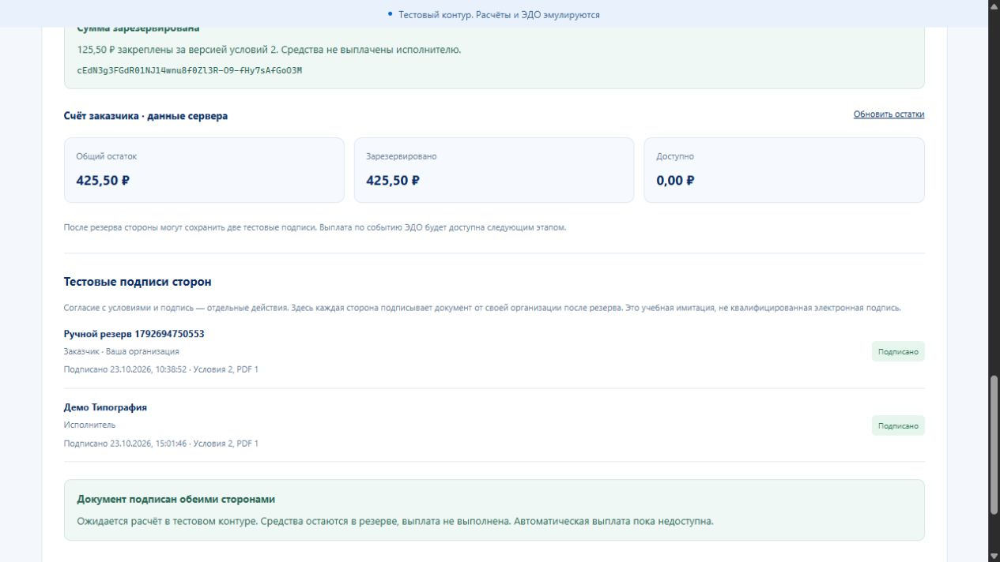

# Тестовые подписи после резерва — 23 октября 2026 года

Этап [PR #14](https://github.com/Adopten123/digital-ruble-deals/pull/14), ветка feature/test-signatures от main 21a6450. Это часть первого тестового прототипа: расчёты и ЭДО эмулируются, квалифицированной подписи и подключения к платформе ЦБ нет. Доставка события / HMAC, входящий inbox, выплата, спор / отмена и A19 этим этапом не реализованы.

## Результат реализации

POST /api/v1/documents/{id}/sign фиксирует подпись только своей действующей организации для точных версий сделки / PDF и SHA-256 после полного резерва и двух согласий. Первая подпись сохраняет FUNDED; вторая атомарно создаёт второй факт, READY_TO_SETTLE, одно неизменяемое основание ЭДО и задание его будущей доставки. Средства остаются в ACTIVE-резерве, проводок выплаты нет.

В edo_outbox исходные bytes, event_id / время и обе ссылки на подписи сохраняются до первой доставки. Задание EDO_EVENT_READY обычного outbox использует тот же event_id. Повтор не создаёт нового основания. Новые функции миграции 006 имеют закреплённый доверенный search_path; факты неизменяемы для ограниченной runtime-роли. Миграции 001–005 не изменены.

Старый ключ возвращает исходный ответ даже после второй подписи; новый ключ возвращает уже созданный собственный факт с текущей сделкой. Это не создаёт подпись повторно после срока / отсутствия файла. Новая подпись повторно проверяет срок после блокировок и чтения файла. UI хранит исходные route / body / key под организацией и сделкой, блокирует новые команды при неизвестном исходе и перечитывает сделку после исторического replay.

## Автоматические проверки

Проверки локально выполнялись с настоящими Go API и PostgreSQL 18.1 на отдельном стенде localhost:18080 / 18081, PostgreSQL 127.0.0.1:55439. Использованы синтетические организации и учебные средства. База и прежние ручные сценарии сохранены; общий seed не расходуется. Docker локально ограничен WSL2 / виртуализацией.

| Проверка | Фактический результат |
|---|---|
| Полный Go с TEST_DATABASE_URL, vet, сборка | PASS; реальная PostgreSQL |
| Новые Go-проверки | 9 функций: 7 HTTP / PostgreSQL и 2 service unit; роли, неверные привязки / версии, конкурентные команды, срок после ожидания row lock, missing / corrupt PDF, restart / replay и runtime-права; rollback в 3 точках, включая запись основания ЭДО |
| Frontend unit | 47 PASS, включая 5 новых проверок pending / подписей |
| Typecheck приложения и E2E, production build | PASS |
| OpenAPI | PASS: 25 операций совпадают с Go, внутренние ссылки валидны |
| Focused API + UI подписей | 14 PASS за 18,3 с: 10 API + 3 UI + setup |
| Полный локальный E2E после исправления API-фикстуры b86ffd9 | 103 PASS за 3,1 минуты: 52 API + 50 UI + setup, без Playwright retries |
| API после исправления подготовки фикстуры b86ffd9 | 11 PASS за 10,3 с: 10 API + setup |
| Smoke v3 до / после настоящего перезапуска API и повторного bootstrap | PASS: PDF, два согласия, резерв, две подписи / READY, ledger и исходные результаты сохранились; общий seed и демосчёт исполнителя не изменены |

Три UI-сценария подписей проверяют обе роли / настоящий фильтр READY и остатки; потерю реального ответа после commit с reload, историческим replay и чтением актуального READY; смену организации при сохранённой команде и независимую подпись другой стороны. Поддержан viewport 320. Весь E2E также содержит прежнюю layout-матрицу 187 сочетаний; это проверки Chromium, а не всех физических устройств / zoom.

### Найденные проблемы подготовки проверок

Первый smoke нового этапа неверно сравнивал операторский DTO счёта (с полем organisation) с DTO собственного счёта. Исправлено сравнение пяти общих полей; повторный запуск и проверка после перезапуска успешны. Это дефект проверки, не движения денег. Созданные учебные записи не удалялись.

Первый полный локальный E2E дал 100 PASS / 3 FAIL: старые UI-тесты авторизации исчерпали штатный бюджет после расширения API-набора. Помощник проверяет настоящий 429 / RATE_LIMITED и Retry-After, ожидает указанное время и повторяет отправку один раз. Следующий полный прогон дал 103 PASS. В Linux CI на 59abfab более быстрые регистрации новых API-фикстур также получили 429: 100 PASS / 3 FAIL; code job, Go race и Compose / bootstrap / restart smoke при этом прошли. Исправление b86ffd9 сохраняет отдельную организацию на тест, те же регистрационные данные, обязательный 201 и один ограниченный повтор только явного 429. Неизвестные исходы / 5xx / второй 429 не повторяются. Продуктовые лимиты не ослаблены.

После исправления b86ffd9 полный локальный набор повторён: 103 PASS за 3,1 минуты. Актуальные результаты Linux CI и логи привязаны к [проверкам PR #14](https://github.com/Adopten123/digital-ruble-deals/pull/14/checks); слияние выполняется только после зелёных проверок финального HEAD. Неуспешные ранние прогоны не считаются зелёной приёмкой.

## Ручная проверка нового этапа

Реальный браузерный прогон 23 октября, роли переключались через выход / форму входа. Сохранился заказчик предыдущего [ручного прогона](2026-10-22-reserve-recheck.md), без API-подготовки новых данных: «Ручной резерв 1792694750553». Проверялась вторая независимая сделка GT_wE74sm2qVGadqIU6Bf-EmewwcqOPmTXvqGkuWmbU на 125,50 ₽, условия v2 / PDF v1, printing-acceptance.pdf, 19 798 байт. Срок — 25 октября, 12:00 Europe/Moscow. SHA-256: 4c44fed4dbb9b7b7c9c42fcb764023bea01d2aa5b3aff6f3d92b8a1252ee46c5. Все данные учебные.

| Кейс | Действие / наблюдение | Результат |
|---|---|---|
| S01 | Сохранённая сессия, FUNDED, прежний PDF / два согласия, ACTIVE 125,50; заказчик 425,50 / 425,50 / 0 | PASS |
| S02 | Собственный checkbox содержит точные версии; без него кнопка подписи недоступна | PASS |
| S03 | Подпись заказчика 23.10.2026 10:38:52: FUNDED, исполнитель ожидается, повторная кнопка скрыта; остатки прежние | PASS |
| S04 | Reload и повторное открытие карточки: первая подпись и резерв сохранены | PASS |
| S05 | Вход исполнителем: видна подпись заказчика, своё отдельное действие; редактирование закрыто, приватные остатки заказчика не показаны | PASS |
| S06 | Подпись исполнителя 23.10.2026 15:01:46: READY / «Ожидает расчёта», обе подписи; явный текст об отсутствии выплаты | PASS |
| S07 | Кабинет исполнителя 0 / 0 / 0; повторный вход заказчиком 425,50 / 425,50 / 0 | PASS |
| S08 | Выбор «Ожидает расчёта» + «Найти» оставляет одну нужную сделку | PASS |
| S09 | В общем списке другая сделка 300 ₽ по-прежнему FUNDED; суммарный резерв 425,50 ₽ сохранён | PASS |
| S10 | Карточка двух подписей на 320×812: визуально нет наложений, documentWidth=viewportWidth=320, выходов элементов main за экран 0; консоль warn/error=[]; временный размер сброшен | PASS |

Итог выполненного ручного набора — **10 PASS**. Это целевой прогон новой функции, не исполнение всей инструкции MANUAL_TESTING.md. Потеря ответа и подмена полномочий доказаны автоматическими тестами; вручную сетевые отказы этим прогоном не воспроизводились.

### Снимки

[Первая подпись, FUNDED](assets/2026-10-23-test-signatures/first-signature.jpg), [вторая подпись со стороны исполнителя](assets/2026-10-23-test-signatures/second-signature.jpg), [повторный вход / остатки заказчика](assets/2026-10-23-test-signatures/customer-balances.jpg), [полная карточка 320px](assets/2026-10-23-test-signatures/ready-320.jpg).

### Read-only сверка данных после UI

Отдельная транзакция PostgreSQL READ ONLY завершена ROLLBACK. Для выбранной сделки: READY_TO_SETTLE, 2 подписи разных организаций, 1 edo_outbox и 1 pending EDO_EVENT_READY с тем же event_id; raw bytes соответствуют payload, точным сторонам / версиям / хешу и двум signature_id. Резерв cEdN3g3FGdR01NJ14wnu8f0Zl3R-O9-fHy7sAfGoO3M остаётся ACTIVE 12550 RUB. Заказчик 42550 / 42550 / 0, исполнитель 0 / 0 / 0. Другая сделка IPawQk2OptdfnK8eeCH6mXDKqxTsrMImghGYpVCKq5I — FUNDED, 0 подписей / оснований ЭДО. По всем счетам стенда: 0 расхождений total с ledger и reserved с ACTIVE-резервами; 0 несбалансированных пачек.

## Ограничения и следующий этап

Просмотр Blob-PDF был заблокирован политикой браузерного инструмента в предыдущем прогоне; открытие / скачивание файла здесь не повторялись и новый ручной PASS им не присвоен. Метаданные / SHA-256 не заменяют визуальную проверку содержимого. Подробности исходного BLOCKED сохранены в предыдущем отчёте. Другие браузеры, физические устройства, полный zoom-набор, длительная сессия и A19 здесь не принимались.

Следующий этап — доставка неизменяемого события с проверкой источника / HMAC / повторов, inbox и единственная выплата. Выплату необходимо реализовывать вместе с блокирующими действиями и гонками спор / отмена / срок, точной сверкой основания, ledger и отсутствием второй выплаты. READY_TO_SETTLE этого не доказывает. После этапа повторяются сквозная приёмка и ручной UI.
