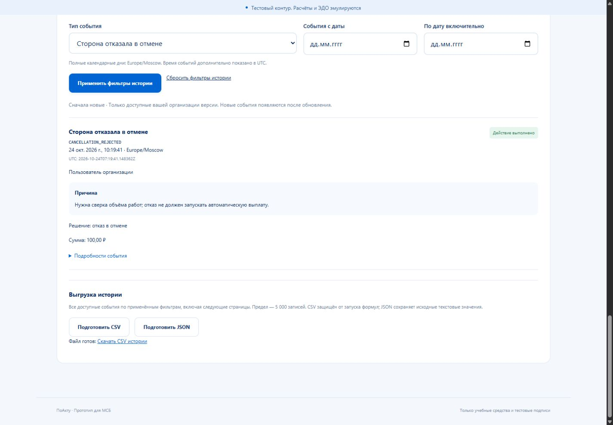
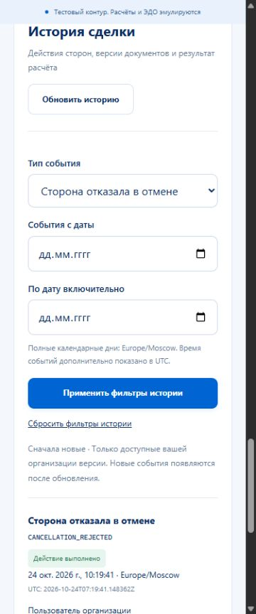
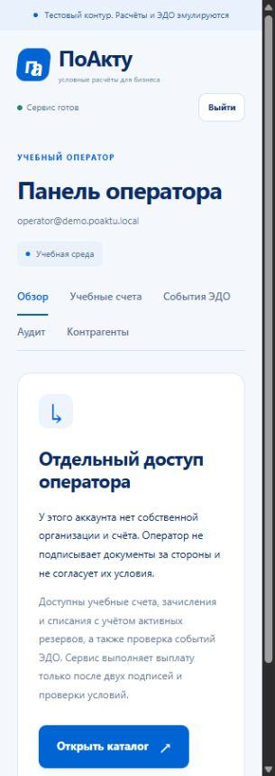
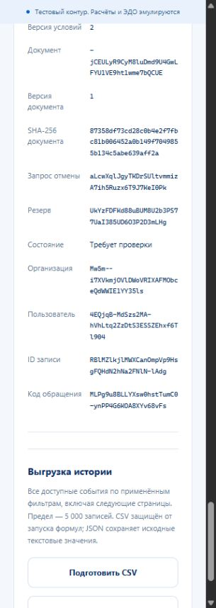

# История сделки и экспорт — проверка 24 октября 2026 года

Ветка feature/deal-history-export, [PR #16](https://github.com/Adopten123/digital-ruble-deals/pull/16). Сервер / OpenAPI — b7fec32, интерфейс — 37fa587, системные регрессии — f98fcf7. Документация первоначально опубликована в d7f8e4e; дополнительная проверка Compose выявила настройки прокси / тестовой CSS-фикстуры, исправленные отдельным коммитом. Окончательные CI / merge доступны в PR. Тестовый контур, все счета, пользователи, подписи и расчёты учебные.

## Результат

Реализованы история сделки, CSV / JSON и отдельный аудит оператора. Публичная проекция выбирает только разрешённые поля сохранённых событий. SQL проверяет текущего участника и его участие в исторической версии; прежний исполнитель теряет доступ, новый не получает прежний раунд. Нет raw payload, email / названий из снимков команд, паролей, cookie, HMAC, storage key или байтов PDF. Неизвестные типы — RECORDED без деталей. Экспорт свыше 5000 событий отклоняется без частичного файла.

Миграции 001–008 и денежные writers не менялись. Новый модуль читает существующий аудит. Это не независимое доказательство целостности A19; уведомления ещё не доставляются.

## Автоматические проверки

- Полный Go с настоящей PostgreSQL, vet и сборка API — PASS. Аудит: 7 unit + 3 HTTP / PostgreSQL-теста; лимит 5001, scope / роли, исторические версии, курсоры, точные фильтры, UTC / наносекундные границы, allowlist и CSV.
- 63 frontend unit, оба TypeScript-проекта, производственная сборка и OpenAPI 35/35 — PASS.
- Общий E2E после первых исправлений: **132 PASS за 5,9 минуты** — 66 API + 65 UI + setup. После финальной правки минимальной ширины отдельно повторены все новые UI: **9 PASS за 12,5 с**, включая setup, стабильное место под полосу прокрутки и переходы между всеми вкладками оператора. Повторные unit / build после этой правки успешны. Финальный общий Linux CI проверяется отдельно перед merge.
- Smoke v5 до / после настоящих повторных migrate / bootstrap / перезапуска API — PASS. Сравниваются точная история, JSON-экспорт, исходные результаты команд / inbox / доставки, единственный payment_id и прежние остатки. Новые денежные фикстуры используют две свежие организации; общий seed не расходуется.

Первый focused-прогон: 13 PASS / 2 FAIL — исправлены CRLF-нормализация текста внутри CSV и несогласованный 403 оператору вместо 404 закрытого ресурса. Первый общий прогон: 126 PASS / 6 FAIL — исправлены коллизия класса document-facts, совпадающая подпись события / текущего состояния резерва и переполнение вкладок оператора. Старые проверки не ослаблялись. В CI первого серверного коммита один из двух прогонов выявил прежнюю гонку теста потерянного ответа: pending отображается до отправки запроса. Тест теперь явно ждёт реального 201 после commit, затем проверяет сохранённое состояние; второй прогон того же серверного кода прошёл. Финальный HEAD включает исправленную синхронизацию.

В [Linux CI на d7f8e4e](https://github.com/Adopten123/digital-ruble-deals/actions/runs/40096671990) полный Compose-прогон дал 126 PASS / 6 FAIL: nginx добавлял второй X-Content-Type-Options к заголовку Go, а две новые layout-проверки пытались добавить inline CSS, запрещённый production CSP. Прокси теперь скрывает upstream-копию и выдаёт один nosniff, включая свои ошибки; существующая транспортная проверка усилена до точного значения. Layout-фикстура загружается отдельной same-origin CSS-ссылкой, без изменения CSP или обхода её проверки. Проверки данных и прав не ослаблены. После исправления локально пройдены оба TypeScript-проекта и targeted-набор транспорта / истории / Swagger: **24 PASS за 21,2 с**. Окончательный общий CI повторяется на новом HEAD.

## Ручной UI

Среда: in-app browser, localhost:18080 / отдельный API 18081, PostgreSQL18.1. Использованы ранее созданные ручные сделки и аккаунты двух организаций / учебного оператора. В этом ручном прогоне денежные команды и подписи не выполнялись. Сроки и факты прежнего прогона сохранены.

| Код | Действия и наблюдение | Итог |
|---|---|---|
| H01 | Заказчик открывает прежнюю REFUNDED-сделку на 100 ₽: видны 10 фактов, спор, два запроса отмены, отказ первой и согласие второй; исходные причины сохранены | PASS |
| H02 | Тип CANCELLATION_REJECTED → ровно одно решение; раскрыты организация / пользователь, версия условий 2, PDF1 / SHA256, request ID и ID закрытого запроса; UTC рядом с Europe/Moscow | PASS |
| H03 | Подготовить / скачать JSON через UI с тем же фильтром; файл прочитан: один CANCELLATION_REJECTED, точная кириллическая причина, SUCCEEDED как сохранённое решение стороны | PASS |
| H04 | Подготовить CSV с тем же применённым фильтром: появляется ссылка «Скачать CSV истории»; побайтовое содержание и фактическое скачивание CSV проверены автоматикой | PASS |
| H05 | Изменить тип без применения: есть объяснение, обе кнопки подготовки заблокированы, старая ссылка отозвана | PASS |
| H06 | Применить EDO_EVENT_REJECTED к сделке без таких событий: пустая история с понятным сообщением, без подмены прежними строками | PASS |
| H07 | История / фильтры / длинные ID при 1440 /375 /320; на 320 сначала выявлен скролл из-за body min-width320 при clientWidth305. После исправления scrollWidth=clientWidth=bodyRight=305, горизонтальной полосы нет | PASS после исправления |
| H08 | Вход оператором, фильтр ID прежней SETTLED-сделки и DEAL_SETTLED: ровно один факт 30000 коп., источник edo-emulator и прежний payment_id oNWzVrjQ03P_IF3Nw6W_vJI3-Kfawy3v1xp6DVZjbdg | PASS |
| H09 | Сброс фильтров операторского журнала, «Показать ещё»:20 →40 событий, первая страница остаётся, новые записи добавлены | PASS |
| H10 | Все 5 вкладок оператора открыты кликами при 320; две строки навигации без наложения, scrollWidth305. Возврат заказчику показывает прежние 100 ₽ /0 в резерве; viewport сброшен | PASS |

Ручной JSON-файл сохранён браузером в Downloads; он не добавлялся в Git. Содержимое CSV / формулы, смена исторического исполнителя, потерянные ответы / межвкладочная смена аккаунта, 5001 запись и наносекундные границы подтверждены автоматическими сценариями, а не объявлены ручными действиями. Просмотр Blob-PDF повторно не запускался: прежнее ограничение инструмента остаётся в отчёте расчёта. Проверки другого компьютера / настоящего ЭДО / реальных средств не выполнялись.

Итоговая read-only сверка БД: 0 расхождений total / ledger и reserved / ACTIVE; у прежней ручной сделки один settlement и один DEAL_SETTLED. SHA256 четырёх пользовательских файлов исходной папки совпали с исходным снимком, output/ сохранён.

## Снимки

## Границы и следующий шаг

Signed keyset закрепляет верхнюю пару первой страницы, но не общий MVCC-снимок нескольких HTTP-запросов: поздний commit с ранним created_at может появиться дальше. Один экспорт читает один SQL-снимок. CSV нейтрализует формулы апострофом, JSON сохраняет исходный текст; это разные представления одной доступной выборки.

Дальше по MVP — доставка уведомлений из outbox с сохранённым read-state; затем независимый A19, изолированное пересоздание учебного сценария и проверка запуска на втором ПК. Пользовательские файлы исходной рабочей папки и output/ сохранены вне коммитов этапа.
