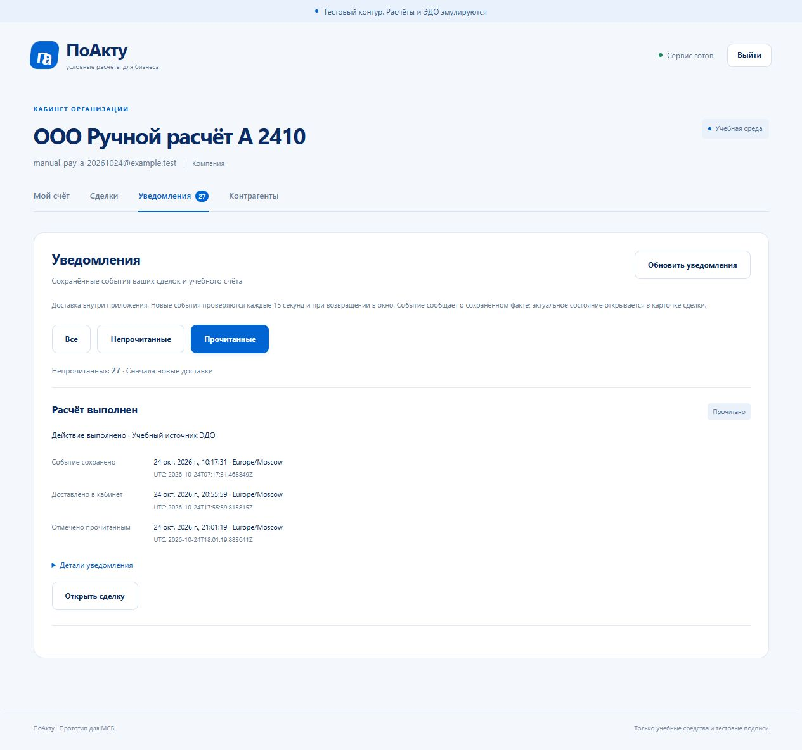
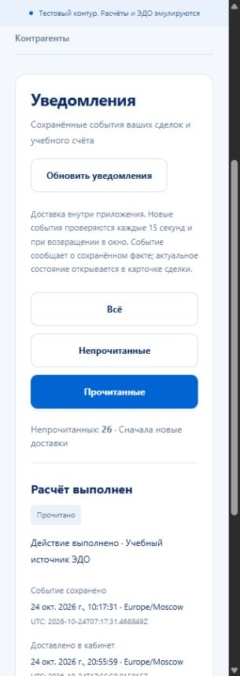

# Проверка уведомлений «ПоАкту», 24–25 октября 2026

Ветка `feature/in-app-notifications`, [PR #18](https://github.com/Adopten123/digital-ruble-deals/pull/18). Только синтетические организации, учебные средства и подписи. [Контракт](../NOTIFICATIONS.md), [ручная инструкция NOT01–NOT14](../MANUAL_TESTING.md), фактические публикация / CI — в [STATUS](../STATUS.md).

## Реализованное поведение

Миграция 009 добавляет личные уведомления с FK на аудит, получателем / организацией, уникальным основанием и первой неизменяемой датой прочтения. Worker общей outbox создаёт уведомления и ACK одной PostgreSQL-транзакцией после commit доменного результата, без внешней сети. Список, счётчик и read повторяют одинаковые проверки получателя, действующего членства и текущей / исторической стороны. Вложенный AuditEvent не выдаёт сырые payload / снимки команд / секреты. Время исходного факта отделено от времени доставки старой очереди.

Повтор AGREE под новым ключом или от второго owner не подменяет исходного автора / времени настоящего agreement, даже когда повторный job опережает заблокированный original. ACK технического EDO_EVENT_READY не подтверждает доставку ЭДО / выплату; специализированная очередь продолжает расчёт. Ошибки worker журналируются фиксированной категорией без SQL / payload / DSN, не чаще минуты; восстановление отмечается отдельно.

Frontend: вкладка / счётчик, три фильтра, страницы, личная прочитанность и новый защищённый переход к актуальной сделке. Polling каждые 15 секунд и при фокусе; отмена и проверка поколения запроса не дают перенести старый ответ в новый фильтр / аккаунт. POST read строго без тела и Idempotency-Key. OpenAPI 0.7.0 содержит 37 операций.

## Автоматические результаты

| Проверка | Фактический результат |
|---|---|
| Полный Go с настоящей PostgreSQL, vet, API build | PASS; 13 новых Go-функций: 4 unit, 5 PG/HTTP, 3 реальных flow и upgrade |
| Upgrade 008 → 009 | PASS; заполнены четыре lifecycle и проводки, все старые строки сохраняются до worker после повторных migrate / bootstrap |
| Доставка backlog / повторное открытие сервисов | PASS; 44 сообщения (23 заказчику /21 исполнителю), стабильные IDs / read_at / ACK, прежние PDF / ответы / деньги и независимый ACTIVE-резерв |
| Actual demo upgrade | PASS; до первого старта worker количество / fingerprints всех 27 прежних таблиц совпали после migrate / обоих grants / bootstrap |
| Frontend | 71 unit PASS, оба typecheck / build PASS, OpenAPI 37/37 |
| Новый focused API / UI | 17 PASS за 32 с (8 API +8 UI +setup) |
| Полный E2E | 148 PASS за 6,5 минуты (74 API +73 UI +setup) |
| После финального исправления автообновления | 9 UI/setup PASS за 19,4 с; повторные 71 unit / типы / build PASS |
| Smoke v6 до / после реального restart | PASS; точные страницы уведомлений / unread_count / первая дата прочтения, прежние payment_id / исторические ответы и деньги |
| Итоговая read-only сверка | 0 расхождений ledger / резервов, 0 дублей уведомлений, 0 pending outbox; прежняя ручная выплата и её аудит — по одной записи |

API проверяет auth / CSRF / Origin / expected user, строго пустой read и стабильную дату при параллельных повторах, safe DTO, strict query / signed cursor / highwater, независимый unread_count, смену исполнителя, собственные credits / debits, закрытые отмены с причинами, две подписи / одну выплату без повторных денег и сообщений. Go дополнительно проверяет runtime-права, immutable guards / trusted search_path, rollback / SKIP LOCKED / параллельные workers и видимость только после commit. Срок не создаёт вымышленное событие, выплату или освобождение.

UI проверяет реальные страницы / доставку / чтение после reload, потерю 204 после настоящего commit, поздний ответ старого фильтра, timer / focus без пересечения запросов, logout / оператора, 503 и личность получателя, буквальный вывод HTML-подобной причины и ширины 320–1440 с внешней same-origin CSS-фикстурой под CSP. Финальное исправление снимает прежний alert после настоящего успешного polling; тест сохраняет также явный retry и проверки приватности. Независимый review не выявил P1/P2. Проверка документации: 411 локальных ссылок в 49 Markdown-файлах, отсутствующих целей нет.

Первый запуск полного набора остановился в setup на штатном 429 (147 NOT RUN). Следующий дал 140 PASS /8 FAIL за 6,9 минуты: семь старых reserve fixtures получили 429 при регистрации; проверка утечки ошибочно совпала с `PGx` в случайном request_id. Исправлены только тестовые setup / утверждения: один явный повтор по проверенному Retry-After 1–60 с тем же телом и свежим CSRF; строгие наборы ключей ошибки и проверка содержимого error без случайного ID. Product limiter, денежные команды и требования не ослаблены. После исправлений прошли все 148 E2E.

25 октября после паузы тестовые процессы были остановлены. Восстановлены прежний кластер PostgreSQL на 55439, API 18081 и UI 18080, выполнены повторные migrate / bootstrap. Прежний файл smoke v6 от 24 октября прочитан без пересоздания: девять уведомлений заказчика / семь исполнителя, первый read_at и прежние деньги сохранились. Основной стенд 5173 /8081 и старая ручная БД 001–006 не обновлялись.

## Ручной прогон

IAB Chromium, настоящий API 18081 / web 18080, ограниченная runtime-роль. Участники A/B — ранее созданные «ООО Ручной расчёт А/Б 2410», оператор — штатный учебный. Пароли / cookie не включены. Чтение DOM-геометрии дополняло визуальный осмотр; API из браузерного evaluate не вызывался.

| ID | Фактическое действие и результат | Статус |
|---|---|---|
| NOT01 | После upgrade: A 27 /B 25 непрочитанных. У расчёта факт `07:17:31Z`, доставка `17:55:59Z`; местные даты и UTC разделены. | PASS |
| NOT02 | A: 20 →27 строк после «Показать ещё», 27 уникальных IDs, кнопка в конце исчезла; счётчик 27. | PASS |
| NOT03 | A отметил расчёт: 27 →26, метка «Прочитано», первый read_at `2026-10-24T18:01:19.883641Z`; деньги не изменились. | PASS |
| NOT04 | «Прочитанные» — одна строка при общем счётчике 26; после reload дата в точности прежняя. | PASS |
| NOT05 | Переход из уведомления открыл актуальную MANUAL-PAY-2410 /300 ₽: завершённый расчёт, две подписи, использованный резерв и остаток A 100/0/100 ₽. | PASS |
| NOT06 | После выхода A / входа B тот же расчёт у B — новое уведомление; прочитанные пусты, счётчик B 25, даты чтения A нет. | PASS |
| NOT07 | Desktop /320 /375: при системной полосе 15 px clientWidth = scrollWidth = bodyRight 305/360; проверенные фильтры / кнопки / даты не выходят за границу. | PASS |
| NOT08 | B создал для A черновик 0,01 ₽; счётчик без ручного refresh 25 →26, один новый DEAL_CREATED. После входа A увидел тот же черновик и увеличение своего непрочитанного набора до 27 при сохранённой прочитанной строке. | PASS |
| NOT09 | Вход оператора: пять прежних вкладок, клиентских уведомлений / счёта нет. Во время параллельной E2E-нагрузки ранее получен явный 429; после завершения нагрузки / восстановления стенда вход успешен. | PASS |
| NOT10 | 25 октября после restart / повторного bootstrap A вошёл вновь: тот же первый read_at, одна прочитанная строка, 27 непрочитанных и остаток 100/0/100 ₽. | PASS |

Всего NOT01–NOT10: **10 PASS**. NOT11–NOT14 (ручной HTTP / сеть / смена стороны / дубликаты) здесь **NOT RUN вручную**; автоматические проверки описаны отдельно и не повышают ручные статусы.

Новый ручной черновик `_DYqrwDnce98SET7ymuoFnSfL5hjUzIxw__ldanwswk`, «MANUAL-NOTIFY-2410 — новая доставка»: B — заказчик, A — исполнитель, 0,01 ₽, срок 31 октября 15:30 Europe/Moscow. Средства не резервировались. При вводе срока первое ArrowUp изменило 31-й день на 1-й: локальная проверка правильно запретила прошлую дату. После явного исправления сохранён 31 октября. Это ошибка ввода инструментом, не дефект приложения. Прежний расчёт и отмены сохранены.

## Границы и публикация

Не выполнена полная ручная матрица физических устройств / других браузеров / zoom. Нет независимого A19, email / SMS, уведомления лишь по таймеру срока и CLI нового сценария. Blob-PDF повторно не открывался; прежняя блокировка инструмента не объявляется исправленной. Локальный Docker Engine ограничен WSL2 / виртуализацией: Compose / nginx / Linux race подтверждаются CI окончательного HEAD отдельно. SQL guards и прочитанность не защищают от владельца всей инфраструктуры; A19 — отдельный этап.

PR #17 объединён в main `74d5299`; его [последующая проверка main](https://github.com/Adopten123/digital-ruble-deals/actions/runs/40118543805) успешна. Уведомления опубликованы отдельными коммитами / push: сервер `2aa7428`, клиент `d4f851e`, UI-регрессии `66ec3fa`, восстановление после 503 `827fc60` и итоговые документы. Обе проверки `66ec3fa` прошли: [PR](https://github.com/Adopten123/digital-ruble-deals/actions/runs/40119488497), [push](https://github.com/Adopten123/digital-ruble-deals/actions/runs/40119485450). Финальные CI / merge сверять в PR #18; локальные результаты их не заменяют. Четыре пользовательских файла исходной папки совпадают с прежними SHA-256; output/ сохраняется.
