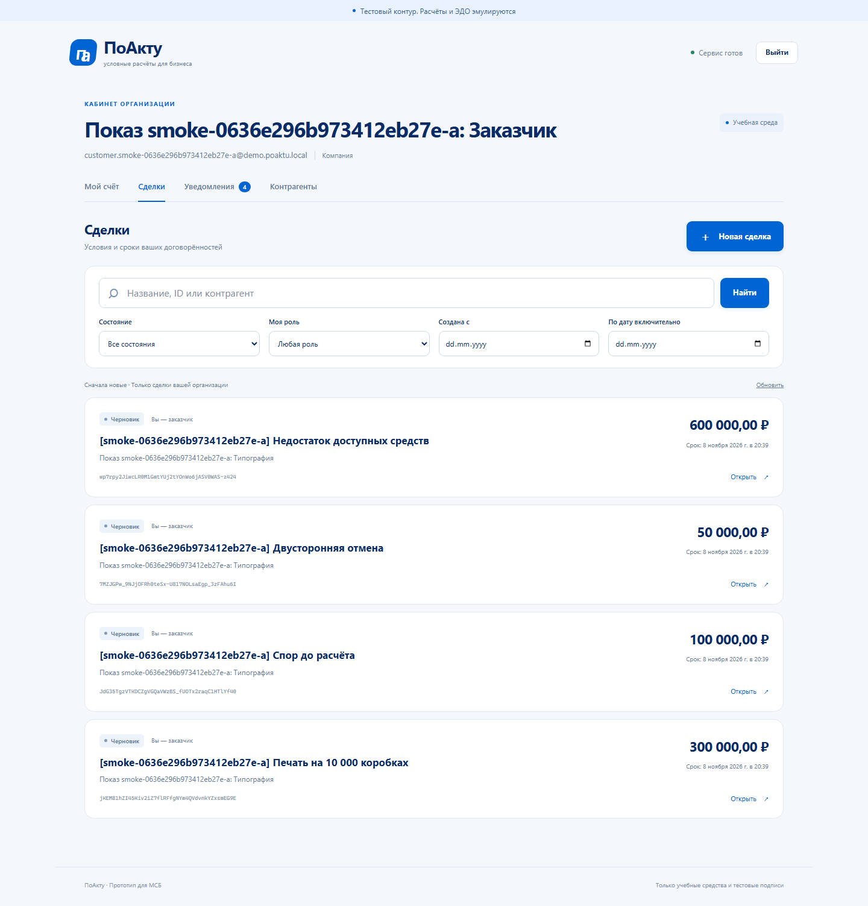
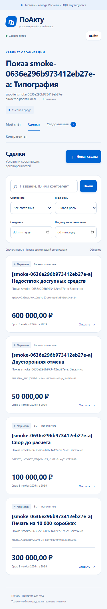
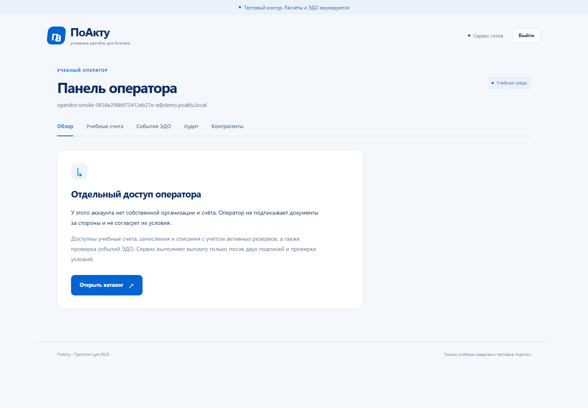

# Приёмка отдельного демопоказа

25 октября 2026 года. Ветка feature/isolated-demo-run от main aeade9e, [PR #20](https://github.com/Adopten123/digital-ruble-deals/pull/20). Тестовый контур. Расчёты и ЭДО эмулируются.

## Результат

CLI demo create готовит новые роли / организации / счета и четыре DRAFT, сохраняя прежние данные. Начальные 50 000 000 копеек выдаются один раз сбалансированной проводкой. Согласия, резерв, подписи, спор / отмена и выплата остаются настоящими действиями участников. [Инструкция / повторы / права / ограничения](../DEMO_RUN.md).

Новых HTTP-маршрутов, миграций и изменений frontend-кода нет: схема 010 и OpenAPI 0.8.0 с 37 операциями. Новый marker находится в уже покрываемой A19 таблице bootstrap_runs; начальный аудит и все сделки входят в прежнюю цепочку. Оператор системный, с прежним общим обзором учебного контура. Изолируются стороны, их счета и сделки, а не отдельный экземпляр PostgreSQL.

## Выполненные проверки

| Проверка | Результат |
| --- | --- |
| PostgreSQL нового модуля | PASS: новый / повтор / отдельный run, 6 конкурентных повторов, конфликт разных паролей, сохранность старых счетов сторон, отсутствие чужого доступа |
| Rollback | PASS: занятой email и переполнение эмиссии int64 не оставляют части учёток, денег, marker или аудита |
| Прерывание | PASS: после seed и первых двух черновиков следующая попытка создаёт оставшиеся без второй эмиссии |
| Ограниченная роль | PASS в PostgreSQL и реальном CLI: OWNER_REQUIRED, записей нет |
| После настоящей выплаты | PASS в HTTP-тесте и CLI/API smoke: те же IDs, SETTLED / payment_id / остатки / аудит без нового seed |
| Пароль / повторы | PASS: отдельные Argon2id-соли, секрет не входит в manifest / audit; другой пароль или APP_KEY конфликтует |
| Файл | PASS: LF / CRLF, сохранение пробелов, запрет нескольких строк / control / малого пароля; общий reader сохраняет проверки A19 |
| Истёкшая неполная подготовка | PASS unit: RUN_EXPIRED вместо совета бесконечного повтора; настоящий 14-дневный интервал не ожидался |
| Go | Два полных go test ./... с PostgreSQL PASS, включая окончательную классификацию ошибок; vet / сборка и targeted cmd / demo PASS. Финальные CI — в PR |
| Frontend / Swagger | 71 unit, typecheck, typecheck:e2e, production build и 37/37 операций OpenAPI PASS |
| Новый сквозной smoke | PASS на localhost:18080 / настоящем API / PostgreSQL: CLI fresh / repeat / runtime отказ, две независимые группы, три роли UI, расчёт, повтор bootstrap и paid replay |
| UI | Заказчик / оператор 1440 px, исполнитель 375 px: вход, исходные остатки, четыре строки DRAFT, отсутствие лишнего счёта оператора, horizontal overflow=false и 0 pageerror; снимки просмотрены |
| Compose / JS | Конфигурация base + compose.demo.yaml и node --check scripts/demo-smoke.mjs успешны. Реальный Compose проверяет Linux CI |

Полный прежний 148 E2E-набор локально на этом этапе ещё раз не запускался: клиент не менялся. Новый smoke отдельно проверяет три роли и финансовый путь. Оба финальных Linux CI запускают весь прежний набор, Go race / PostgreSQL и новый smoke; окончательные run IDs / merge смотреть в PR #20. Предыдущий main CI A19 [40214676860](https://github.com/Adopten123/digital-ruble-deals/actions/runs/40214676860) завершился success.

## Ручные команды на итоговом бинарном файле

Подготовлен свежий jury-20261025 с четырьмя неоплаченными DRAFT. Секретный входной файл и JSON manifest сохранены только в игнорируемом work, в Git / отчёт не входят. Это ручная проверка CLI; интерфейс проверялся автоматизированным Playwright-прогоном и просмотром его снимков.

| Кейс | Наблюдение | Итог |
| --- | --- | --- |
| DEM01 | Новый run-id, существующий частный файл пароля, owner | DEMO_READY /0 |
| DEM02 | Те же аргументы повторно | resumed=true, все четыре ID совпали /0 |
| DEM03 | ID ../invalid | INVALID_ARGUMENT /2 |
| DEM04 | DEMO_MODE=false | UNAVAILABLE /3 |
| DEM05 | Runtime DATABASE_URL | OWNER_REQUIRED /3 |
| DEM06 | Иной пароль с прежним ID | RUN_CONFLICT /2 |
| DEM07 | Другой 32-байтный APP_KEY_FILE с прежним ID | RUN_CONFLICT /2; реальный ключ не менялся |
| DEM08 | API заменён итоговым бинарным файлом и перезапущен; повтор CLI | readiness успешна, resumed=true и те же четыре ID /0 |

Старые тестовые данные не удалялись. Прежние четыре пользовательских исследовательских файла и output основной рабочей папки не включаются в коммиты. Начальный системный DEMO_ISSUANCE закономерно уменьшается на каждое новое зачисление; изменение этого счёта не является сбросом чужих средств.

Финальная read-only сверка: 0 расхождений проекций счетов / резервов, 0 несбалансированных batches, глобальная сумма 0, pending outbox 0. У jury-20261025 одна seed-проводка и четыре DRAFT, заказчик 50 000 000 /0 коп., исполнитель 0/0. Прежняя ручная выплата остаётся единственной; старые ручные остатки 10 000 /0 и 30 000 /0 коп. сохранены. SHA-256 четырёх пользовательских файлов совпали с исходным снимком, output/ сохранён. Проверены 467 файловых ссылок в 49 Markdown-файлах: отсутствующих целей нет.

Два независимых read-only review проверили сервис / репозиторий / CLI и тесты / Compose / CI: P1/P2 не обнаружены. Ревьюеры не меняли файлы и не запускали дополнительные тесты. Ограничения глобального оператора, нескольких транзакций подготовки и исходного характера manifest отражены в инструкции.

## UI-снимки успешного нового smoke

Снимки сделаны Playwright после входа, до PDF / резерва / подписей. Они подтверждают показ исходного набора; не означают ручной проверки полного процесса / настоящего zoom / другого браузера.

## Непройденные попытки и исправления

Две первые попытки нового smoke остановились на согласии: helper передавал фиксированную версию 1 после генерации PDF. Сервер правильно отклонил VERSION_CONFLICT, резерв / выплата не создавались. Helper теперь берёт фактическую deal_version из ответа генерации и связывает с ней оба согласия / резерв / подписи. Третья попытка прошла весь путь. Непройденные учебные данные сохранены, ограничения сервера не ослаблялись.

Ошибки классифицированы отдельно: незавершённая подготовка после срока требует нового явного ID; конфликт исходного тела требует проверки. Неизвестный сетевой исход commit новой CLI отдельно вручную не воспроизводился; используется прежний UnitOfWork и сохранённый seed / идемпотентные CREATE_DEAL, а тест прерывания подтверждает продолжение после известного commit. Автоматического удаления / сброса / обновления A19-эталона нет.

Далее — окончательные CI / merge в PR и проверка запуска на втором пользовательском ПК. Linux CI является проверкой чистого Compose, а не выполненным ручным тестом на физическом втором устройстве. Открытые матрицы zoom / устройств и R05 Blob-PDF остаются в BACKLOG.

Пользователь выбрал Windows + Docker Desktop для следующего ПК. Подготовлен [чек-лист](../SECOND_PC_WINDOWS.md) с отдельным Compose project, согласованными origin / портом, частным файлом и проверкой после restart. WIN01–WIN10 пока NOT RUN; существование инструкции не считается выполненной проверкой. В справочниках исправлены прежние текущие ссылки на readiness 009 / notifications — фактическая схема 010 / audit_integrity.

Дополнительный read-only review Windows-инструкции заметил возможный ложный отказ readyz сразу после restart. Перед публикацией добавлено явное ожидание health через up -d --wait api web. Семь PowerShell-блоков разобраны парсером без ошибок; API генератора случайного пароля проверен без вывода секрета. Это проверка инструкции на текущем ПК, не WIN01–WIN10 на втором устройстве.
